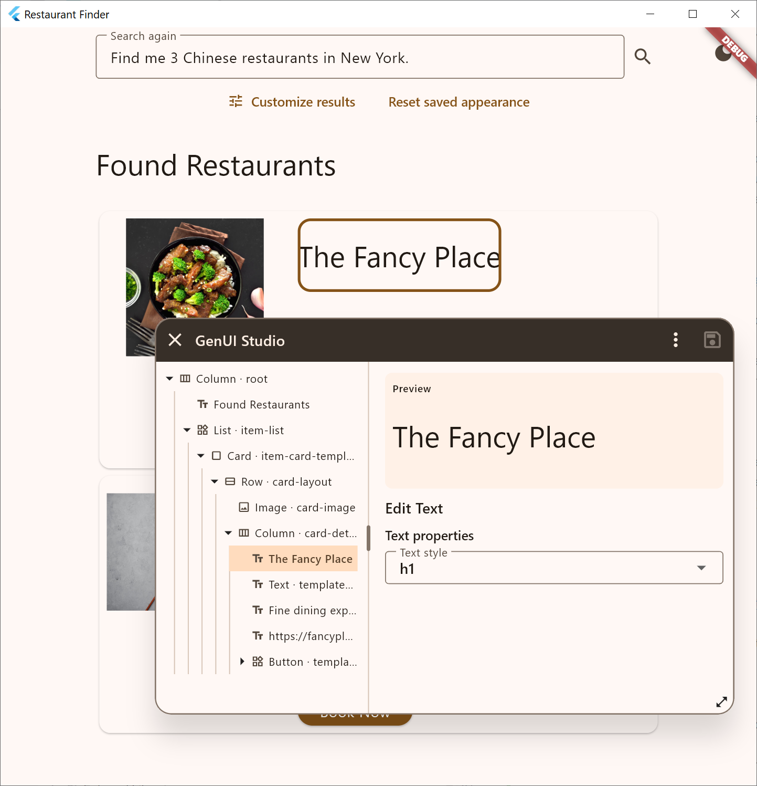
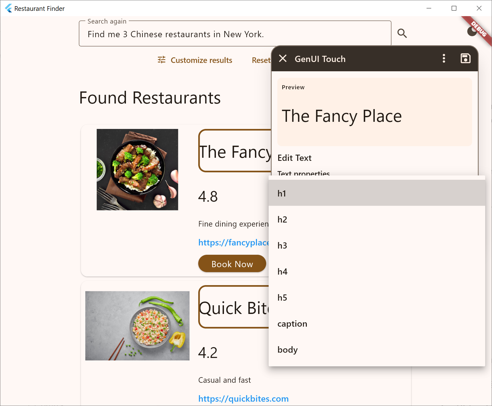

# GenUI Customizer

**Runtime visual customization for Flutter GenUI applications.**

GenUI generates interfaces dynamically. GenUI Customizer lets developers and users adjust the appearance of those interfaces **in the running application**, without changing source code or editing A2UI JSON.

Open the Studio over the live UI. **Triple-click** a widget on desktop or **long-press** it on touch devices to select it, then edit the properties the host application has made available. Changes appear immediately; undo, redo, discard, and save are supported. Manual editing does not require an AI service.

<!-- SCREENSHOT: Studio open over the running application, with a selected widget and property editor visible. -->
<!--  -->

## Where it can help

- **Developer:** inspect and tune generated widgets in their real application context, without rebuilding or making another AI call for every visual change.
- **Designer:** refine typography, spacing, images, and other available visual properties directly on a working interface.
- **Multi-tenant app administrator:** adjust catalog widget defaults for a company or team, with the scope and permissions managed by the host app.
- **End user:** personalize selected parts of their own interface, manually or with optional AI assistance.

Unlike a theme setting, the Studio can edit **individual rendered widgets** as well as **defaults for catalog widget types**. It does not replace an application's theme or design system.

## Two editing modes

| Surface | Gallery |
| --- | --- |
| Customize a specific widget in the current generated UI. | Customize default property values for a widget type. |
| Select it by triple-click, long-press, or from the component tree. | Select a catalog widget and edit its preview. |

The Studio is a movable, resizable panel inside the running app. Changes are previewed as you make them. With host-provided storage and stable presentation roles, saved appearance settings can be reapplied to later generated content.

<!-- SCREENSHOTS: Surface selection and editing; Gallery default editing. -->
<!--  -->
<!--  -->

## Example

The [Restaurant Finder example](example/README.md) uses recorded agent responses by default. You can try selecting, editing, saving, and restoring customizations without configuring an AI service.

Optional AI integration can provide scoped property editing or propose new generated surfaces. Human edits and AI generation can be combined, subject to the host application's integration.

<!-- VIDEO: Insert a link to a real screen recording of runtime selection, manual editing, optional AI refinement, and persistence. -->
<!--  -->

## Integration

1. Register permitted visual properties using `EditableCatalogRegistry`.
2. Attach `GenUiCustomizer` and decorate catalog items with `decorateEditableCatalogItem`.
3. Open `showEditableGenUiStudio`; optionally provide `EditableGenUiStorage` and `EditableGenUiComposer`.
4. Store `GenUiAppearanceProfile` values and apply them to incoming `updateComponents` messages using stable presentation roles.

Only host-approved properties are editable. Data bindings, actions, and component relationships remain protected. The host controls authorization, storage, and the scope of saved preferences.

For local development, the repository pins Flutter **3.47.9** in `.fvmrc` (`fvm use`).

## Project status

**Experimental.** APIs and behavior may change without backward compatibility. This project is developed with **heavy use of AI**, including AI-assisted coding; its implementation should be reviewed and tested accordingly.

GenUI Customizer focuses on runtime visual customization. It is **not a design-time UI builder** or a replacement for Flutter development tools. Feedback and contributions are welcome.